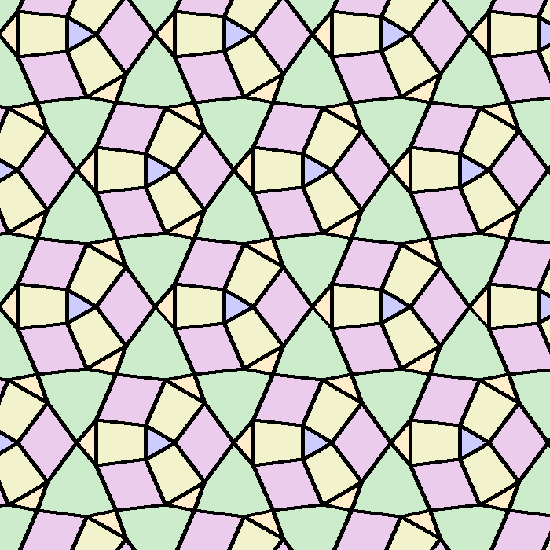

# Caleidoscope

[](https://github.com/nvcleemp/caleidoscope/actions/workflows/tests.yml)

Creating repeating patterns

## Overview

Caleidoscope is a Python library for creating and working with repeating
patterns and tilings. You describe a fundamental tile (its vertices, edges,
and optionally polygons) together with edge identifications, and Caleidoscope
derives the transformations needed to tile a region with copies of it.



*A decorated p31m tiling, rendered by
[`examples/png_decoration/`](examples/png_decoration/).*

## Requirements

- Python >= 3.13
- [uv](https://docs.astral.sh/uv/) for environment and dependency management
- Optional, only for turning TikZ output into videos (see
  [below](#turning-tikz-output-into-videos)): `latexmk` with a TeX
  distribution that includes TikZ, `pdftoppm` (from poppler-utils), and
  `ffmpeg`

## Installation

This repository is a `uv` workspace. From the repository root:

```bash
uv sync
```

This installs the `caleidoscope` library (`libs/caleidoscope/`) into a shared
`.venv/`, editable, so changes to its source take effect immediately.

## Using the library

A pattern is built from a fundamental tile plus a list of edge
identifications; each identification tells Caleidoscope to derive a
transformation that maps one edge onto another, which becomes a generator
for tiling the plane.

```python
from caleidoscope import Pattern, TikzRenderer

# A unit square, with its left/right and bottom/top edges identified so it
# tiles the plane by translation.
vertices = [(0, 0), (1, 0), (1, 1), (0, 1)]
edges = [(0, 1, "bottom"), (1, 2, "right"), (2, 3, "top"), (3, 0, "left")]
identifications = [
    ((0, 3), (1, 2), True),  # left edge -> right edge
    ((0, 1), (3, 2), True),  # bottom edge -> top edge
]
pattern = Pattern(
    vertices, edges, [], center=(0.5, 0.5), tolerance=0.01, identifications=identifications
)

tikz_code = pattern.render(TikzRenderer(), width=6, height=6)
```

The inverse of every generator is used as well, so the square above tiles in
all directions even though each identification only lists one direction.
Pass `include_inverses=False` to `Pattern` to use only the generators derived
from the identifications, as earlier versions did; this keeps the
construction order (and so the numbering of tiles in
`ConstructedPattern.get_tiles()`) the same as before.

`render()` is a convenience method that constructs the pattern and renders it
in one step. If you need to render the same pattern multiple times (e.g.
with different edge filters or styles), call `pattern.construct(...)` once to
get a `ConstructedPattern`, then call `.render(...)` on it as many times as
needed without redoing the tiling computation.

`TikzRenderer`, `SvgRenderer`, and `PngRenderer` are the renderers currently
provided; other output formats can be added by implementing the `Renderer`
protocol (see `caleidoscope.renderers.base`). The three aren't drop-in
interchangeable in code that assumes a particular return type:
`TikzRenderer.finalize()` returns a string, `SvgRenderer.finalize()` returns
an `xml.etree.ElementTree.Element` (the `<svg>` root), and
`PngRenderer.finalize()` returns a `PIL.Image.Image`.

## Running the examples

Examples live under `examples/`. Each one is its own directory and its own
`uv` workspace member, with its own `pyproject.toml` depending on
`caleidoscope`. Run any example script with:

```bash
uv run --package <package-name> python examples/<directory>/<script>.py
```

`<package-name>` is the `name` field in that example's `pyproject.toml`
(usually matching its directory name, with underscores as hyphens). This
applies to every example, current and future.

For convenience, the root [`Makefile`](Makefile) defines a shorthand target
per example script, e.g. `make run-basic-classify` or `make run-two-tilings`.
New scripts need a target added manually.

`examples/basic/` contains small, single-feature demo scripts — see
[`examples/basic/README.md`](examples/basic/README.md) for what's there.

## Turning TikZ output into videos

Several examples write a `.tex` file with one standalone TikZ picture per
page, each page being one animation frame.
[`scripts/tex-to-video.sh`](scripts/tex-to-video.sh) turns such a file into
an `.mp4`: it compiles it to PDF with `latexmk`, rasterizes each page with
`pdftoppm`, and encodes the frames with `ffmpeg`. The video plays the frames
forward and then backward, so it loops smoothly in players that don't
support ping-pong playback.

```bash
scripts/tex-to-video.sh <input.tex> [output.mp4] [--fps N] [--dpi N]
```

The output defaults to `<input>.mp4` next to the `.tex` file; `--fps`
defaults to 12 and `--dpi` to 300.

The examples that produce such files (`decoration`, `glue_and_split`,
`p31m_tiling`, `two_tilings`) each have a `Makefile` that wraps the script:
run `make videos` in the example's directory after generating its output.
See that example's README for details.

## Development

Run the test suite with:

```bash
uv run --package caleidoscope pytest
```

`pytest-cov` is a dev dependency of `caleidoscope`, so you can check test
coverage with:

```bash
uv run --package caleidoscope pytest --cov=caleidoscope --cov-report=term-missing
```

`--cov-report=term-missing` lists the specific lines each file is missing
coverage for. Add `--cov-branch` to also track branch coverage, not just
line coverage.

See [`AGENTS.md`](AGENTS.md) for more on the workspace layout and running
things across workspace members.

## License

Caleidoscope is released under the [MIT License](LICENSE).
